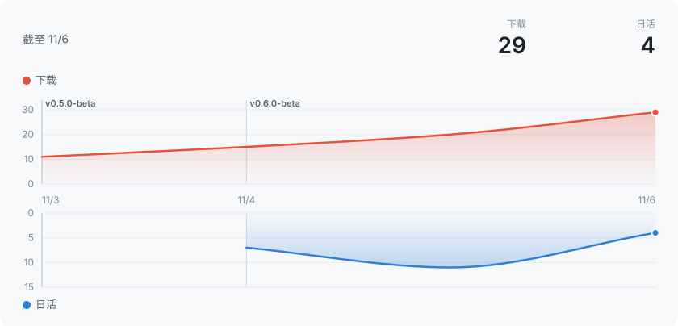

# 声墨

闻声成墨，落墨成声。

声墨是一个在自己电脑上运行的 AI 语音软件：把文字配成语音、克隆声音、把录音和视频转成文字。所有处理都在本机完成，文字和声音不会上传到任何地方。

## 能做什么

- **配音**：粘贴文案自动切句，一句一句生成、试听、重来；支持多个角色，每句可以单独调语速和情感
- **快速配音**：拖一段声音进来，直接用这个声音念一句，结果可以直接拖进剪映、PR
- **克隆声音**：录一段或上传 10～20 秒的音频，就能用这个声音配音；也可以用一句话描述来设计声音
- **转写**：音频、视频识别成文字，区分说话人，导出字幕
- **导出**：WAV 音频和 SRT 字幕

## 下载

到 [Releases](../../releases/latest) 下载最新版的 `ShengMo_版本号_x64-setup.exe`，双击安装。

第一次打开时会提示下载基础模型（约 3 GB），下好就能用。以后有新版本，软件里会提示更新。

## 系统要求

- Windows 10 / 11，64 位
- 有独立显卡更快，没有也能用
- 硬盘留出至少 5 GB（模型可以放到别的盘）

## 安装时提示「Windows 已保护你的电脑」

安装包还没有做微软的代码签名，Windows 会拦一下。点「更多信息」→「仍要运行」即可。

## 下载统计

每天自动更新。累计下载是手动下载安装包的次数（不含自动更新）；每天检查更新约等于每天在用的人（软件每天最多自动检查一次）。

## 关于模型

声墨用的都是公开发布的开源模型，每个模型有自己的许可证，在软件的模型页里能看到能不能商用。个别模型下载前要先同意它的协议。
