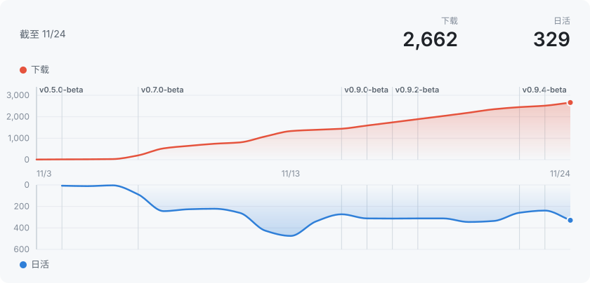

# 声墨

闻声成墨，落墨成声。

声墨是一个在自己电脑上运行的 AI 语音软件：把文字配成语音、克隆声音、把录音和视频转成文字。所有处理都在本机完成，文字和声音不会上传到任何地方。支持 Windows 和 macOS（Apple 芯片）。

## 能做什么

- **配音**：粘贴文案自动切句，一句一句生成、试听、重来；支持多个角色，每句可以单独调语速和情感
- **快速配音**：拖一段声音进来，直接用这个声音念一句，结果可以直接拖进剪映、PR
- **克隆声音**：录一段或上传 10～20 秒的音频，就能用这个声音配音；内置 OmniVoice 覆盖 600+ 语言，也可以用一句话描述来设计声音
- **转写**：音频、视频识别成文字，区分说话人，导出字幕
- **多种模型**：内置多个开源模型，也能自己导入引擎支持的 GGUF 模型
- **导出**：WAV 音频和 SRT 字幕

## 下载

到 [Releases](../../releases/latest) 下载最新版：

- **Windows**：`ShengMo_版本号_x64-setup.exe`，双击安装
- **macOS（Apple 芯片）**：`声墨_版本号_aarch64.dmg`，打开后把「声墨」拖进「应用程序」

第一次打开时会提示下载基础模型（约 3 GB），下好就能用。以后有新版本，软件里会提示更新。

## 系统要求

- **Windows** 10 / 11，64 位；有独立显卡更快，没有也能用
- **macOS**：Apple 芯片（M 系列），自动用 Metal 加速
- 硬盘留出至少 5 GB（模型可以放到别的盘）

## 第一次打开被系统拦住

安装包还没有做系统的代码签名 / 公证，首次打开会被拦一下，确认一下就行：

- **Windows**：「Windows 已保护你的电脑」→ 点「更多信息」→「仍要运行」
- **macOS**：「无法验证开发者」→ 右键点「声墨」→「打开」

## 下载统计

## 关于模型

声墨用的都是公开发布的开源模型，每个模型有自己的许可证，在软件的模型页里能看到能不能商用。个别模型下载前要先同意它的协议。
